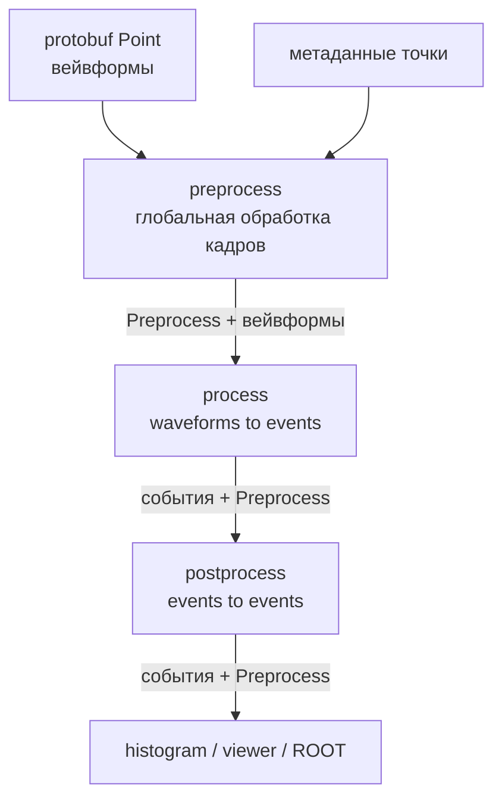

# 1. Процессинг, препроцессинг, постпроцессинг и отладочный рендеринг

- Статус: принято
- Дата: 2026-10-08

## Контекст

Пайплайн обработки NUMASS в крейте `numass-processing` разбит на три стадии:
препроцессинг (`preprocess.rs`), процессинг (`process.rs`) и постпроцессинг
(`postprocess.rs`). Документ фиксирует их разбиение, назначение и связность, а
также устройство отладки.

Требование к отладке: **в batch-режиме выполняется ровно тот же код, что и при
визуальном тестировании**, чтобы не «наиграть» ошибок в отдельной batch-ветке.
Разница — только отключение отрисовки, а не замена алгоритма.

## Тип исходных данных

Исходные данные — **синхронизированные осциллограммы**: при аппаратном триггере
с платы приходят вейвформы со **всех включённых каналов**, независимо от наличия
событий. На уровне protobuf точка (`rsb_event::Point`) имеет иерархию
`канал → блок → фрейм`, где фрейм несёт время триггера и сырые отсчёты.

Для экономии памяти применяется **программный zero-suppression**, который должен соответствовать аппаратному 1 к 1, но на
практике может «разъехаться». Реализован на стороне сбора в
`tqdc-controller-rust`.

## Зачем задумывались три стадии

### 1. Препроцессинг — глобальная обработка кадров (waveform → waveform, с сохранением иерархии)

Общая для всех алгоритмов обработка кадров: коррекция базовой
линии, сужающие (шумоподавляющие) фильтры, очистка от шумов.

Текущая реализация:
- `extract_waveforms` — zero-copy **переразметка** `канал → блок → фрейм` в
  время-ориентированную структуру (channel-major → time-major); отсчёты не
  копируются и не меняются. Это ожидаемо: хранилище использует legacy-формат,
  начальный ремаппинг допустим, а сохранение структуры выполняется уже после
  него.
- `Preprocess::from_point` не трансформирует вейвформы, а считает метаданные
  точки: `baseline`, `bad_blocks`, `frame_len`, `hv`, времена.

### 2. Процессинг — извлечение событий (waveform → events)

Из вектора вейвформы — несколько чисел на событие; из одной вейвформы может
получиться **0, 1 или несколько событий** (`Trapezoid` — несколько, остальные —
0 или 1). 

Текущая реализация:
- Событие описывается каналом, амплитудой и служебными атрибутами
(размер, пометки переполнения/аппаратного сброса).
- На уровне кадра извлечение возвращает события без времени, но на уровне точки они **группируются по времени триггера** — время сохраняется как ключ группировки. При этом синхронизированный «кадр» сплющивается: события всех каналов одного таймстампа лежат плоским списком.

### 3. Постпроцессинг — работа с событиями (events → events)

Обрабатываются **только события**, без обращения к вейвформам. Абстрактно:
объединение событий, разделённых малым промежутком времени (в т. ч. «сплитов» —
электрон попал в несколько соседних пикселей), отбрасывание событий из дефектных
участков набора, игнорирование каналов, учёт виртуального мёртвого времени.

Текущие шаги: `merge_close_events`, `merge_splits`, `cut_bad_blocks`,
`merge_frames`, игнорирование каналов/границ.

Шаг **опциональный**: входное и выходное представления совпадают, поэтому его
можно пропустить или прогонять многократно.

## Связность стадий

Стадии связаны **через общий тип-контракт `Preprocess`** и представление
«события + метаданные точки»:

- `Preprocess` создаётся из метаданных точки и алгоритма; это единственная точка
  вычислений препроцессинга. От алгоритма зависит лишь решение, считать ли
  `baseline` (зашито на `Trapezoid`).
- Процессинг получает `Preprocess` и использует из него только `baseline`
  (`Trapezoid`, `LongDiff`; `Average` считает базу локально), а **возвращает**
  его дальше.
- Постпроцессинг использует из него `bad_blocks` (`cut_bad_blocks`) и
  `frame_len` (`merge_frames`).

Связь процессинга с препроцессингом сильнее, чем следует из названий: из
`preprocess.rs` импортируются не только `Preprocess`, но и ядро обработки —
`emulate_fir` (трапецеидальный фильтр) и `extract_waveforms`/`frame_to_waveform`
(zero-copy переразметка). Сами `process` и `postprocess` друг о друге не знают:
их связывает только пробрасываемый `Preprocess` и общие типы событий.

## Обработка ошибок

В модуле намеренно используется `panic!` на любой ошибке вместо её обработки:
либо выполняется ровно то, что задумано, либо программа крашится, а не молча
выдаёт некорректный результат. Это упрощает поиск расхождений ценой отсутствия
восстановления после ошибки.

## Отладочный рендеринг (фича `egui`)

Две ортогональные вещи:

1. **Cargo-фича `egui`** — все блоки отрисовки обёрнуты в
   `#[cfg(feature = "egui")]`.
2. **Параметр `ui: Option<&mut PlotUi>`** в рисующих функциях, тоже объявленный
   как `#[cfg(feature = "egui")]`. Без фичи он исчезает из сигнатуры, а с фичей
   при `ui = None` отрисовка не выполняется.

Три режима:

| Режим | Условие | Назначение | Отрисовка |
| --- | --- | --- | --- |
| Медленный | `egui` + `ui = Some(..)` | одиночный кадр (filtered-viewer) | есть |
| Быстрый | `egui` + `ui = None` | пакетная обработка | нет |
| Самый быстрый | без фичи `egui` | неграфическая обработка | не компилируется |

`ui` пробрасывается сквозь обе стадии: в процессинге рисует отфильтрованный
сигнал, базовую линию, порог, отметки reset/overflow; в постпроцессинге — точки
и линии-связки слияния.

Batch-входы `extract_events` и `post_process` передают `None`, визуальный
viewer — `Some(plot_ui)`. Алгоритмический код **не дублируется**: одна ветка
используется и визуально, и в пакете, а отрисовка — строго побочный эффект в
`#[cfg]`-блоках.

## Последствия

**Плюсы**

- Единая кодовая база для визуального тестирования и batch — невозможна
  рассинхронизация алгоритмов, а отладочный код отключается на этапе компиляции.
- Чёткая граница через `Preprocess`: вычисляется один раз на точку,
  переиспользуется процессингом и постпроцессингом.
- Постпроцессинг — опциональный `events → events` с совпадающими типами, что
  даёт гибкую композицию.

**Минусы / технический долг**

- `Preprocess` перегружен: несёт и метаданные точки, и выведенные данные
  (`baseline`, `bad_blocks`, `frame_len`). `baseline` жёстко привязан к
  `Trapezoid`.
- Ядро `emulate_fir` и переразметка осциллограмм живут в `preprocess.rs`, хотя
  применяются в процессинге — граница «препроцессинг = waveform→waveform»
  размыта.
- Ручное пробрасывание `ui` через сигнатуры требует `#[cfg]`-параметра в каждом
  вызове, а отдельные `#[cfg]`-блоки внутри алгоритмов зашумляют код.

## Открытые вопросы / TODO

- Вынести `baseline`-логику из жёсткого `match` в `Preprocess::from_point`.
- Прояснить место `emulate_fir` и `extract_waveforms`: оставить как общее ядро
  или выделить отдельный модуль.
- `cut_bad_blocks` сейчас работает только при `merge_close_events = true`.
- Валидировать программный zero-suppression (соответствие аппаратному 1 к 1).
