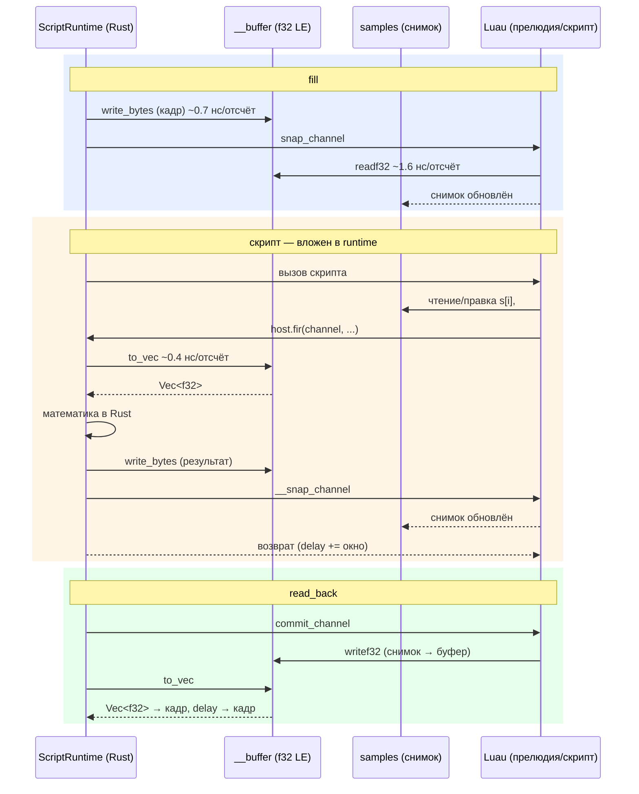

# 5. Встраиваемый скриптинг в стадию process

- Статус: принято
- Дата: 2026-10-20 (решение), 2026-10-23 (реализация на Luau)
- Исследование кандидатов: [docs/research/embedded-scripting-candidates.md](../research/embedded-scripting-candidates.md)

## Решение

Скриптовый движок стадии process — **Luau через крейт [ulua](https://crates.io/crates/ulua)**
(чистый Rust-порт Luau, 0.1.7; jit-фича = ulua-codegen, native x64/aarch64 codegen;
wasm32 — интерпретатор). Реализация: [numass-processing/src/script.rs](../numass-processing/src/script.rs),
шаг `PreprocessStep::Script`.

Почему Luau, а не LuaJIT из рекомендации исследования: LuaJIT недоступен как
зависимость (C-сборка, отсутствие wasm-пути и поддержки в экосистеме Rust-крейтов),
а ulua даёт достаточный перф на нативном таргете за счёт JIT-компиляции Luau
(уровень оптимизации 2) и, главное, **нативного типа `buffer`** — байтового массива
внутри VM, через который отсчёты ходят без маршалинга в таблицы. Итоговые числа
(см. «Производительность» ниже) закрыли требование near-native без LuaJIT.

Ключевые свойства реализации:

- **Один рантайм на поток**: `Lua` не реализует `Send`, `ScriptRuntime` живёт в
  потоке, создавшем шаг (каждая точка считает свою VM в `tokio::spawn_blocking`).
- **Снапшот-модель данных**: скрипт работает с обычной таблицей `channel.samples`,
  рантайм синхронизирует её со скрытым Luau-буфером (см. ниже).
- **Тяжёлая математика — host-функции**: `host.fir/lpf/hpf` выполняются в Rust
  над копией буфера; скрипт их вызывает одной строкой.
- **Fail fast**: ошибка скрипта или host-функции — `ScriptError` (= `ulua::Error`),
  шаг возвращает `Err`, пайплайн падает (ADR 0002).
- **Один и тот же код в batch и вьювере**: скрипт компилируется и исполняется
  одним и тем же `ScriptRuntime` на обоих путях (ADR 0002).

## Скрытый буфер: как работает

Проблема, которую решает буфер: передача отсчётов между Rust и Luau через таблицу
стоит ~23 нс/отсчёт на элемент (бокс на каждый `f32`), что на кадре в 2000 отсчётов
даёт ~90 мкс только на одну сторону — доминирующая стоимость всего шага. Luau-буфер
(`buffer` в Luau, `ulua::Buffer` в Rust) — непрозрачный байтовый массив внутри VM:
Rust пишет/читает его сплошными `memcpy`-подобными операциями (~0.4–0.7 нс/отсчёт,
в 30–50 раз дешевле таблиц), а Luau-циклы по нему (`buffer.readf32`/`writef32`)
попадают под JIT и стоят ~1.6 нс/отсчёт.

### Устройство канала

Тело канала (`body`) — обычная Lua-таблица, которую видит скрипт:

```text
body = {
    samples = { ...отсчёты... },   -- таблица-снимок: обычный синтаксис s[i], #s
    delay    = <number>,           -- задержка канала
    __buffer = <buffer>,           -- скрытый буфер f32 LE (ключ не виден скриптам)
}
```

Ключ `__buffer` (`BUFFER_KEY` в script.rs) не виден обычным скриптам, потому что
итерация `for _, channel in frame` проходит по кадру, а не по телу канала.
Скрипт оперирует только `samples` и `delay` — контракт задан definitions-файлом
[defs.d.luau](../numass-processing/src/scripts/defs.d.luau) (`Channel = { samples: {number}, delay: number }`).

### Три представления отсчётов

1. **`Vec<f32>` кадра** (Rust, `ProcessedFrame`) — источник истины между кадрами.
2. **Скрытый буфер** (`__buffer`, байты f32 LE) — быстрый канал обмена Rust↔Luau.
3. **Таблица-снимок** (`samples`) — то, что видит скрипт; обычный Luau-синтаксис.

### Синхронизация на кадре

На каждый кадр рантайм выполняет три фазы:

1. **`fill`** (Rust, `ScriptRuntime::fill`): отсчёты кадра записываются в буфер
   (`buffer.write_bytes`, ~0.7 нс/отсчёт), затем прелюдийная функция
   `snap_channel` переносит буфер в таблицу-снимок **Luau-циклом под JIT**
   (`buffer.readf32`, ~1.6 нс/отсчёт; Rust-обход таблицы через ulua-rt в ~13 раз
   медленнее, поэтому копирование — на стороне Luau). Таблицы и буферы
   переиспользуются между кадрами (`ChannelScratch`): длина кадра в точке постоянна,
   аллокация один раз; при смене длины буфер пересоздаётся.
2. **Скрипт + host-функции**: скрипт читает/пишет `samples` обычным синтаксисом;
   host-функция (`host.fir` и т.п.) читает буфер целиком в `Vec<f32>`
   (`channel_samples`, ~0.4 нс/отсчёт), считает в Rust и пишет результат обратно
   в буфер (`set_channel_samples`), после чего вызывает `__snap_channel` — снимок
   обновляется, и скрипт сразу видит новые значения. Если операция укорачивает
   сигнал (FIR), `delay` тела увеличивается на ширину окна (`add_delay`).
   Скрипт может и сам писать в буфер через `host.refresh(ch)` (буфер → снимок),
   но прямая запись в `__buffer` скриптам недоступна.
3. **`read_back`** (Rust, `ScriptRuntime::read_back`): прелюдийная `commit_channel`
   переносит правки скрипта из таблицы-снимка в буфер (Luau-цикл,
   `buffer.writef32`), затем Rust читает буфер целиком (`buffer.to_vec`,
   ~0.4 нс/отсчёт) и кладёт отсчёты и `delay` обратно в кадр.



Инварианты:

- между `fill` и `read_back` буфер и снимок могут расходиться; после `read_back`
  они снова согласованы, и кадр в Rust — единственный источник истины;
- host-функция, изменившая буфер, обязана обновить снимок — скелетон
  `register_channel_op` делает это автоматически; ручная запись в буфер
  (операции вне схемы «канал → канал», например FFT) сопровождается
  `host.refresh(channel)`;
- длина буфера может отличаться от длины снимка (FIR укорачивает сигнал):
  `snap_channel` срезает хвост снимка, `read_back` берёт длину из снимка
  (`raw_len`).

### Производительность

Замеры на i7-13700KF (кадр 4096 отсчётов, из scratch-бенчей и тестов):

| Путь | Стоимость |
| --- | --- |
| Таблицы (старый путь: fill+read_back через raw_set/sequence_values) | ~380 мкс/кадр (95 % времени шага) |
| Буфер: маршализация Rust↔буфер | 0.42–0.68 нс/отсчёт (в ~41 раз дешевле таблиц) |
| Буфер: host bulk (invert / fir27) | 9.5 мкс / 92 мкс на кадр |
| Полный композит «снимок → host.fir → refresh → commit» | ~131 мкс/кадр (против ~1302 мкс табличного пути, ~10×) |
| Lua-цикл по буферу под JIT | ~1.6 нс/отсчёт |
| Интерпретатор (wasm-таргет) FIR27 по таблицам | 4.58 мс/кадр — неработоспособен; буфер+host bulk в wasm = native-wasm |

Вывод: тяжёлая математика — всегда host-функции над буфером; лёгкие
поэлементные операции (invert) в Luau-цикле по буферу тоже быстры, но FFI-вызов
дешевле цикла уже от ~12 FIR-тапов (~50 FLOP/отсчёт).

## Как добавить host-функцию (FFI)

Четыре правки. Пример — `host.hpf(channel, width)`. Состав хоста задаётся
реестром `preprocess_host_ops!` ([script.rs](../numass-processing/src/script.rs)):
регистрация в `install`, hover-подсказка редактора и тайпчек тест-скриптов
получаются автоматически; вручную синхронизируется только definitions-файл
(шаг 3, под сторожем).

### 1. Математика — `src/preprocess.rs`, рядом с `emulate_fir`

```rust
pub fn high_pass(waveform: &[f32], width: usize) -> Result<Vec<f32>, String> {
    if width < 3 {
        return Err(format!(
            "high_pass: window must be at least 3 samples, got {width}"
        ));
    }
    let half = width / 2;
    Ok(waveform
        .iter()
        .enumerate()
        .map(|(index, &sample)| {
            let start = index.saturating_sub(half);
            let end = (start + width).min(waveform.len());
            sample - waveform[start..end].iter().sum::<f32>() / (end - start) as f32
        })
        .collect())
}
```

Некорректные параметры — `Err(String)`, не вырожденный результат.

### 2. Операция — `src/script.rs`: блок `impl ChannelOp` + строка реестра

```rust
struct HpfOp;
impl ChannelOp for HpfOp {
    const NAME: &'static str = "hpf";
    type Args = (u16,);
    fn run(samples: &[f32], &(width,): &Self::Args) -> Result<Vec<f32>, String> {
        high_pass(samples, usize::from(width))
    }
    fn delay_shift(_: &Self::Args) -> i64 {
        0
    }
}
```

и строка в списке реестра:

```rust
preprocess_host_ops! {
    FirOp => "host.fir(channel, left, center, right) — FIR, аналог PreprocessStep::Fir",
    LpfOp => "host.lpf(channel, width) — скользящее среднее (низкие частоты)",
    HpfOp => "host.hpf(channel, width) — вычитает локальное среднее (высокие частоты, width >= 3)",
}
```

Правила:

- скелетон «буфер → математика → буфер + снимок» уже написан в
  `register_channel_op`;
- параметры — кортеж `u16` (конвенция `host.fir`), нецелые и отрицательные
  отсекает конверсия ulua;
- `Err` из `run` — runtime-ошибка Luau: видна шагу (`apply` → `Err`) и
  скрипту (`pcall`);
- сигнал укорачивается/сдвигается — `delay_shift` возвращает ширину окна;
- операция вне схемы «канал → канал» (FFT) — `host.set` в `install` вручную;
  буфер руками не трогать, а при прямой записи обновить снимок через
  `host.refresh(channel)`.

### 3. Объявление — `src/scripts/defs.d.luau`, таблица `host`

```luau
hpf: (channel: Channel, width: number) -> (),
```

Пропуск валит `defs_cover_host_functions` (диф имён) и
`embedded_scripts_typecheck` (`Key 'hpf' not found in table`).

### 4. Тесты — `src/scripts/tests/*.luau` + `#[test]` через `run_script`

```luau
-- src/scripts/tests/host_hpf_matches_native_high_pass.luau
return function(frame: Frame)
    for _, channel in frame do
        host.hpf(channel, 9)
    end
end
```

```rust
#[test]
fn host_hpf_matches_native_high_pass() {
    let mut samples: Vec<f32> = (0..64).map(|i| i as f32 * 0.25).collect();
    samples[40] += 100.0; // событие поверх дрейфа базовой линии
    let channel = run_script(
        include_str!("scripts/tests/host_hpf_matches_native_high_pass.luau"),
        &PreprocessHost,
        samples.clone(),
        3,
    )
    .unwrap();

    assert_eq!(channel.samples, high_pass(&samples, 9).unwrap());
    assert_eq!(channel.delay, 3); // длина и delay сохранены
}
```

- новый `.luau` попадает в тайпчек автоматически — `embedded_scripts_typecheck`
  сканирует каталог; скрипты кастомных хостов живут в
  `scripts/tests/custom_hosts/` и не тайпчекаются;
- для параметров с ограничениями — тест на `RuntimeError`
  (`host_hpf_rejects_narrow_window`);
- запуск: `cargo test -p numass-processing --features egui`.

### Сторожа

| Точка | Сторож |
| --- | --- |
| defs ↔ реестр | `defs_cover_host_functions` |
| hover ↔ реестр | `hover_lines_cover_registered_ops` |
| тест-скрипты ↔ defs | `embedded_scripts_typecheck` (автообнаружение) |
| static_params ↔ defs | `defs_cover_point_fields` |

Ручных точек синхронизации без сторожа не осталось.

## Последствия

- **Плюсы**: near-native перф на нативном таргете без C-зависимостей (ulua —
  чистый Rust); обычный табличный синтаксис для скриптов (снапшот-модель) при
  буферной скорости обмена; тяжёлая математика живёт в Rust и тестируется
  нативно; definitions-файл даёт тайпчек, автодополнение и hover в редакторе
  без внешнего LSP; сторожевые тесты не дают разойтись defs/реестру/скриптам.
- **Минусы / ограничения**: wasm-таргет получает только интерпретатор Luau —
  тяжёлые скрипты в веб-вьювере неработоспособны (4.58 мс/кадр на FIR27);
  в вебе остаются встроенные алгоритмы и host bulk (native-wasm скорость).
  Скрипты с тяжёлой математикой обязаны использовать host-функции — чистый
  Luau-цикл по таблице-снимку медленный (~35–78 нс/отсчёт); путь «цикл по
  буферу» существует, но требует ручной работы с `buffer.*` и `host.refresh`.
- **Путь развития** (из исследования): wasm-плагины (wasmtime/wasmi) для
  песочницы и полиглотности — Стратегия A; Rhai/Koto для конфигурационного
  уровня — Стратегия C. Обе не блокируются текущим выбором: контракт
  «кадр → события» и `#[repr(C)]`-типы переиспользуются.
